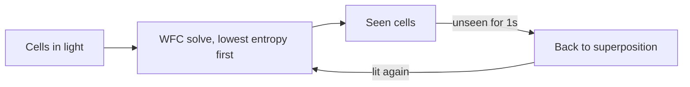

## Decoherence

A small browser game where the world only exists while you're looking at it. Plain JavaScript and a canvas, no frameworks, no build step and no asset files.

Play it from the portfolio's Personal Games page, or open `index.html` from any static server.

### How it plays
- Your light (a 5x5 square) collapses the world around you as you walk.
- Anything out of sight for a second decoheres back into noise, and regrows differently next time you see it.
- Ghosts only move while unobserved. Pick up snowflakes for freeze charges, then tap or click a ghost in your light to freeze it.
- Stand still for five seconds and your light blinks, giving every ghost a free step.
- Reach the green door, then spend gold at the shrine on health or extra freeze slots.
- Find a pumpkin for a Halloween surprise.

### How it works

The world is generated with wave function collapse over 81 tiles. Every tile has a socket on each side (wall, door or room), and neighbours must agree on the socket they share. Weights favour room interiors, so rooms grow into open spaces and corridors become short links between them. An extra rule keeps rooms rectangular. When an area regrows, it has to fit whatever is still collapsed around it, so the world forgets but stays coherent.

| File | Responsibility |
| --- | --- |
| `js/config.js` | Every tunable number |
| `js/wfc.js` | Tile set, sockets, weights and the solver |
| `js/game.js` | Rules: light, memory, ghosts, blink, shrine |
| `js/render.js` | Canvas drawing |
| `js/audio.js` | Synthesised Web Audio sound effects and the dread drone |
| `js/ui.js` | HUD, overlays and keyboard, mouse and touch input |
| `js/main.js` | Boot and the fixed-step game loop |
